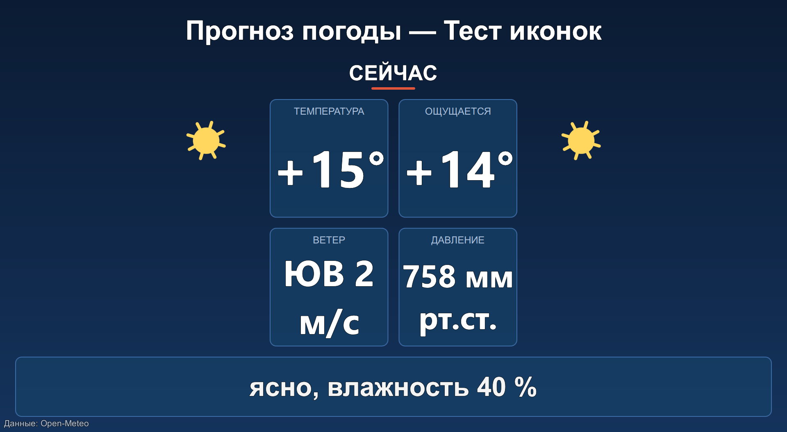
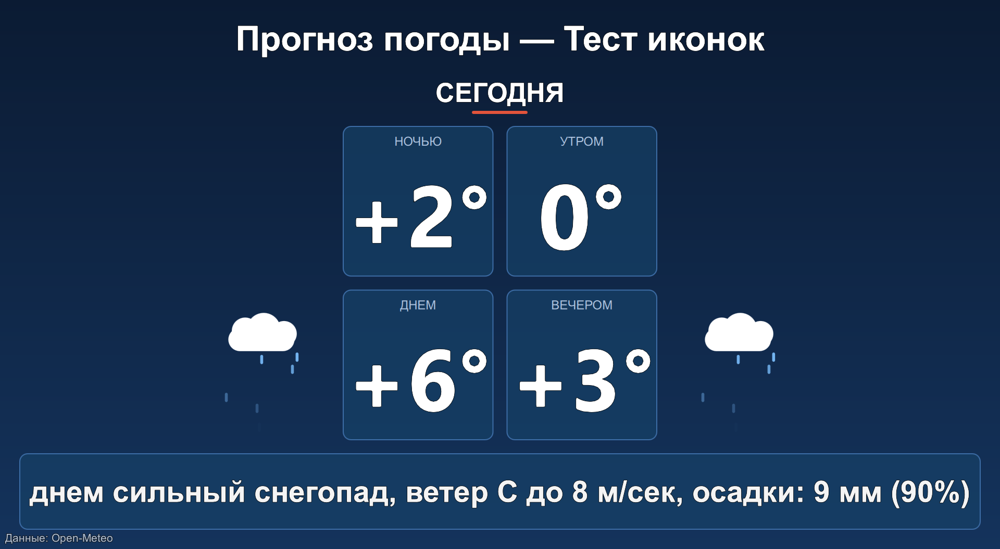
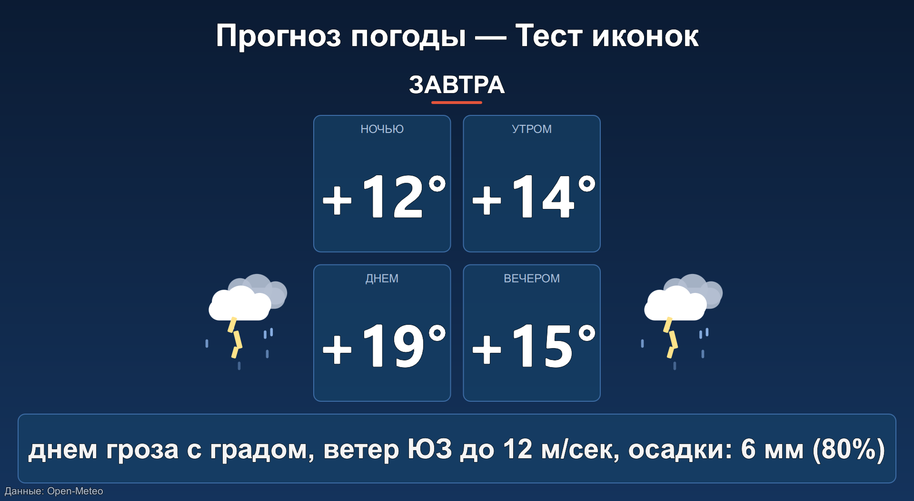

# 🌦 WeatherRoll — полноэкранный прогноз погоды для эфира и табло


-orange)

Полноэкранный показ погоды в городе: **четыре квадрата с крупными данными**,
анимированные погодные иконки, слайды с прогнозом на «Сейчас / Сегодня /
Завтра», видео-заставка и фоновая музыка. Создан как элемент QML для
титровального ПО «Форвард Т» (FDTitle Designer / FDOnAir), но работает и
автономно — на киосках, табло, информационных экранах.

| Заставка | Секция «Сейчас» | Снегопад | Гроза |
|:---:|:---:|:---:|:---:|
|  |  |  |  |

Комплект из двух частей:

1. **WeatherRoll.qml** — полноэкранный показ погоды в городе (титровальный
   элемент QML для ПО «Форвард Т» FDTitle Designer / FDOnAir; подходит и для
   автономного показа через `qml.exe`). Аналог NewsRoll.qml, но на весь экран.
2. **WeatherCollector.exe** — программа, которая каждые 10–60 минут собирает
   погоду из открытых источников и пишет текстовый файл, откуда скрипт берёт
   данные. Умеет работать **службой Windows с автозапуском**.

## Состав

```
WeatherRoll\
├── WeatherRoll.qml            главный полноэкранный скрипт (все настройки внутри)
├── WeatherRoll.ini            настройки показа — правятся здесь, без QML
├── WeatherRollAV.qml          медиа-обёртка (видео-заставка, музыка) — опциональна
├── WeatherRollStandalone.qml  полноэкранная обёртка для автономного запуска
├── weather_collector.py       исходник сборщика погоды
├── WeatherCollector.exe       собранный сборщик (PyInstaller, onefile) — в релизах
├── install_service.bat        установка службы Windows (от администратора)
├── uninstall_service.bat      остановка и удаление службы
├── build_exe.bat              пересборка exe
├── WeatherCollector.ini       настройки сборщика (создаётся при первом запуске)
└── weather.txt                текстовый файл погоды (пишет сборщик, читает скрипт)
```

---

## 1. Формат файла weather.txt

Кодировка **UTF-16 LE с BOM** (так пишет сборщик; скрипт дополнительно
понимает UTF-8 с BOM и UTF-16 BE с BOM — файл можно править в Блокноте).
Первая строка до любого `#` — название города/титул (показывается вверху
страницы). Далее секции:

```
Прогноз погоды в Тихвине
#Сейчас
Температура: +9°C, Ощущается: +7°C, Ветер: ЗЮЗ 3-6 м/с, Давление: 761 мм рт.ст., пасмурно, влажность 87 %
#Сегодня
ночью +8°C, утром +6°C, днем +9°C, вечером +7°C, днем пасмурно, ветер З-ЮЗ 2-3 м/сек, без существенных осадков
#Завтра
ночью +5°C, утром +3°C, днем +8°C, вечером +6°C, днем облачно с прояснениями, ветер Ю до 4 м/сек, осадки: 2 мм (60%)
```

Как скрипт превращает строку в экран:

* строка секции разбивается по запятым на элементы;
* **«ночью +8С»** (также утром/днем/днём/вечером, температура в любом
  написании: `+8С`, `+8 °C`, `-3C`, `12°`) → **квадрат** с подписью времени
  суток и нормализованным значением `+8°C`;
* **«Подпись: значение»** (метка до 24 символов) → **квадрат** «подпись /
  значение» (Температура, Ветер, Давление…);
* всё остальное → текстовая строка описания **под квадратами**
  («днем пасмурно, ветер З-ЮЗ 2-3 м/сек.»);
* первые 4 элемента образуют сетку квадратов 2×2, лишние уходят в описание.

Источник данных показывается **мелкой подписью внизу страницы слева** —
свойство `sourceNote` в WeatherRoll.qml (пустая строка скрывает подпись).
Сборщик ничего лишнего в файл не пишет. (Если добавить в файл секцию
`#Обновлено` вручную, она выведется мелко в правом нижнем углу и не займёт
экрана — совместимость со старыми файлами.)

Файл можно править руками — скрипт перечитывает его каждые 5 минут
(`reloadIntervalMs`) и обновляет показ без перезапуска.

## 2. WeatherCollector.exe — сбор данных

Данные берутся из **Open-Meteo** (open-meteo.com) — открытый источник,
регистрация и API-ключи не нужны. Геокодинг названия города — тоже Open-Meteo.

Для городов **РФ** по умолчанию включено **усреднение трёх моделей**
(`best_match` + GFS + ICON) — по России это заметно точнее одной модели
(управляется `russia_multimodel` в ini: `auto`/`on`/`off`).

Первый запуск (создаёт ini и запускает цикл опроса):

```bat
WeatherCollector.exe --city "Тихвин" --interval 30 --out D:\Project\WeatherRoll\weather.txt
```

Проверить написание города: `WeatherCollector.exe --search "тихв"`

Одно обновление и выход: `WeatherCollector.exe --once`

Все параметры хранятся в `WeatherCollector.ini` (рядом с exe); аргументы
командной строки имеют приоритет:

```ini
[general]
city = Тихвин                  ; город (как в --search)
interval_min = 30              ; период опроса, минут (ограничен 10..60)
output = D:\Project\WeatherRoll\weather.txt
title = Прогноз погоды в Тихвине   ; пусто = «Прогноз погоды — Город (Регион)»
russia_multimodel = auto       ; auto|on|off — усреднение GFS+ICON для РФ
```

При ошибке сети программа сохраняет предыдущий файл (обновление атомарное,
скрипт никогда не видит «полуфайл»). Сборщик работает циклом сам по себе;
при желании его можно не держать запущенным, а ставить в Планировщик задач
Windows (`--once`): `schtasks /create /tn WeatherCollector /tr "...\WeatherCollector.exe --once" /sc minute /mo 30`.

Пересборка exe из исходника: запустить `build_exe.bat` (нужен Python 3.8+;
PyInstaller и pywin32 установятся автоматически).

### Запуск службой Windows (автозапуск после перезагрузки)

WeatherCollector умеет работать как настоящая служба Windows — стартует
автоматически при загрузке компьютера, до входа пользователя в систему:

* **Установка**: правый клик по `install_service.bat` → «Запуск от имени
  администратора» (устанавливает с автозапуском и запускает службу), или
  вручную: `WeatherCollector.exe install --startup auto` затем `start`
  (обе команды — от администратора; работает и порядок
  `--startup auto install`).
* В списке служб (services.msc) она называется **«WeatherCollector —
  сборщик погоды (WeatherRoll)»**, старт **автоматический**, запуск от
  LocalSystem.
* **Управление**: `WeatherCollector.exe stop | restart | remove` или
  стандартными средствами Windows; удаление — `uninstall_service.bat`.
* Настройки те же (WeatherCollector.ini рядом с exe). У службы нет консоли,
  поэтому журнал пишется в **weather_collector.log** рядом с exe. Чтобы файл
  не разрастался, в ini есть два ключа: `log_file = on/off` (off — файл не
  пишется вовсе) и `log_days = 3` (хранить записи не старше N дней, старые
  автоматически удаляются при первом обращении в сутки; 0 — не чистить);
  дополнительно при 1 МБ журнал ротируется в weather_collector.log.old.
* Временно не нужна служба — можно запускать и по-старому, консолью:
  `WeatherCollector.exe` или `--once` (но не одновременно со службой:
  обе копии пишут один файл, обновление останется корректным — атомарная
  замена — но трафик удвоится).

## 3. WeatherRoll.qml — показ

### В FDTitle Designer / FDOnAir («Форвард Т»)

Подключите `WeatherRoll.qml` как титровальный элемент QML и разместите в
регионе на весь экран (например 1920×1080 или 1280×720 — весь интерфейс
масштабируется автоматически). Содержимое файла «Задание» подхватывается
автоматически, если движок передаёт его в QML; иначе читается
`weatherFileUrl`. Для Qt ≥ 6.5 задайте переменную окружения
`QML_XHR_ALLOW_FILE_READ=1` (чтение локальных файлов через XMLHttpRequest).

### Автономно (кеёск/табло)

```
qml.exe WeatherRollStandalone.qml
```

Управление: ←/↑ — предыдущая секция, →/↓/Пробел — следующая, колесо мыши и
свайпы в любую сторону; Esc/Q — конечная заставка, повторно
(в автономном режиме) — выход.

### Настройки

FDTitle Designer **не выводит** пользовательские свойства QML-элемента в свою
панель (в дизайнере у QML-объекта есть только «Общие», «Задание»,
«Выравнивание» и «Собственные»). Поэтому все параметры вынесены в файл
**WeatherRoll.ini**, который лежит рядом с WeatherRoll.qml и перечитывается
вместе с данными каждые `reloadIntervalMs` — правки применяются к показу
без перезапуска (сменить видео/музыку можно только перевыводом элемента).

Формат: строки `ключ = значение` (имена ключей совпадают с именами свойств
из таблицы ниже). **Пустое** значение или отсутствующая строка — используется
значение по умолчанию, заданное в WeatherRoll.qml. После значения можно
писать пояснение, отделив его « ; » (пробел — точка с запятой — пробел) —
всё после него игнорируется (сам файл WeatherRoll.ini уже содержит такие
пояснения у каждого параметра). Пути — с прямыми слэшами
(`file:///D:/...`), цвета — `#AARRGGBB`, true/false — `1/0`, `да/нет`, `on/off`.
Строки с `;` и заголовки `[...]` игнорируются. Заодно параметры можно менять
и в самом WeatherRoll.qml (блок «НАСТРОЙКИ»), а в автономном режиме —
прямо в обёртке WeatherRollStandalone.qml.

| Свойство | Назначение |
|---|---|
| `weatherFileUrl` | путь к файлу погоды (`file:///D:/...`) |
| `backgroundImageUrl` | **выбор фона**: jpg, png (tga — если сборка Qt содержит плагин TGA; при ошибке — градиент) |
| `introVideoUrl` | **видео-заставка в начале** (играет до конца файла) |
| `outroVideoUrl` | **видео в конце** показа (при `loopPlayback: false` или по Esc/Q) |
| `musicUrl`, `musicVolume` | **музыка** во время показа (wav / mp3, по кругу) |
| `splashDurationMs` | длительность статической заставки, мс — ограничена 3000..8000 |
| `sectionShowTimeMs`, `sectionTimes` | время показа секции (общее; по названию — строка `"Сейчас=8000;Завтра=12000"`) |
| `autoAdvance`, `loopPlayback` | автосмена секций; показ по кругу |
| `transitionStyle` | смена секций: `"flip"` (переворот), `"slideLeft"`, `"slideRight"`, `"slideUp"`, `"slideDown"` |
| `transitionDurationMs` | длительность эффекта смены, мс |
| `reloadIntervalMs` | перечитывание файла, мс (0 — выкл.) |
| `cardsMax`, `cardsColumns` | число квадратов (4) и колонок сетки (2) |
| `showWeatherIcon` | анимационные иконки погоды (рисуются QML локально) слева и справа от квадрата с температурой |
| `sourceNote` | мелкая подпись с источником внизу слева (пусто — скрыть) |
| цвета/шрифты | `bgColorTop/Bottom`, `cardColor`, `accentColor`, `fontFamily`… |

### Сценарий показа

1. Заставка: видео `introVideoUrl`, если доступен QtMultimedia; иначе
   анимированная статическая заставка (кольцо, «ПРОГНОЗ ПОГОДЫ», город)
   на 3–8 секунд.
2. Город вверху; на каждом слайде — **крупный заголовок секции** (СЕЙЧАС /
   СЕГОДНЯ / ЗАВТРА), **анимационная погодная иконка** (солнце, луна со
   звёздами, тучи, дождь, снег, гроза с молниями, туман — рисуется самим
   QML, загрузка локальная, вид выбирается по тексту прогноза; две иконки
   встают слева и справа от квадрата с температурой, сетка квадратов
   остаётся по центру), **четыре
   квадрата** с данными, ниже — текст описания («днем пасмурно, ветер…»).
   Смена секций переворотом или слайдом (вправо/влево/вверх/вниз) —
   автоматически и вручную.
3. Музыка играет циклически.
4. `loopPlayback: false` — после последней секции конечное видео
   (`outroVideoUrl`) или плавное затемнение.

### Длительность задания (расписание «Форвард Т»)

Скрипт сам вычисляет длительность одного цикла показа и отдаёт её движку —
поле **«Длительность»** задания в FDTitle Designer и расписании заполняется
автоматически (как у референсных элементов SoftLab): корневое свойство QML
`duration` = заставка + время всех секций (`sectionShowTimeMs` /
`sectionTimes`) + переходы (+ конечное затемнение при показе не по кругу).
Пример: заставка 5 с + 3 секции × 9 с + 3 перехода × 0.8 с ≈ 0:00:34.400.
В эфире автосмена секций идёт только при статусе элемента «Running»
(`SLRunTime.statusElement == 4` — как в шаблонах Яндекс/Гисметео); в
автономном запуске показ идёт всегда. То же исправление внесено в
NewsRoll.qml (длительность = страницы × время показа).

### Примечания по мультимедиа

* Видео и музыка вынесены в `WeatherRollAV.qml` и подхватываются только если
  движок QML собран с модулем QtMultimedia. Если его нет (типично для
  FDTitle Designer), скрипт **не падает**: заставка остаётся статической,
  музыка просто не играет. Все три файла должны лежать в одной папке.
  Форматы видео зависят от кодеков, доступных установленному Qt/системе
  (надёжнее всего H.264/AAC в MP4).
* TGA-фон: стандартно Qt читает JPG/PNG; TGA появляется при наличии плагина
  TGA (входит в `qtimageformats`). Если фон не загрузился, в консоль
  пишется предупреждение и показ идёт на градиенте — конвертируйте файл в PNG.
* Все пути указывайте с прямыми слэшами: `file:///D:/Project/...`.

## 4. Проверенная конфигурация

Сборщик протестирован 12.10.2026 на городе Тихвин (Ленинградская обл.):
текущая погода + прогноз на сегодня/завтра, усреднение best_match+GFS+ICON,
выходной файл читается скриптом без правок.
